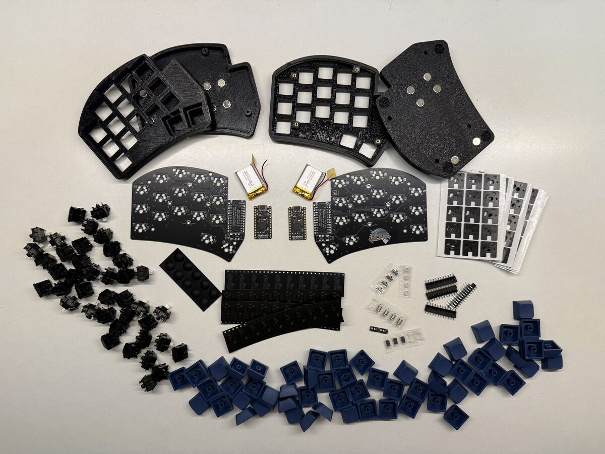
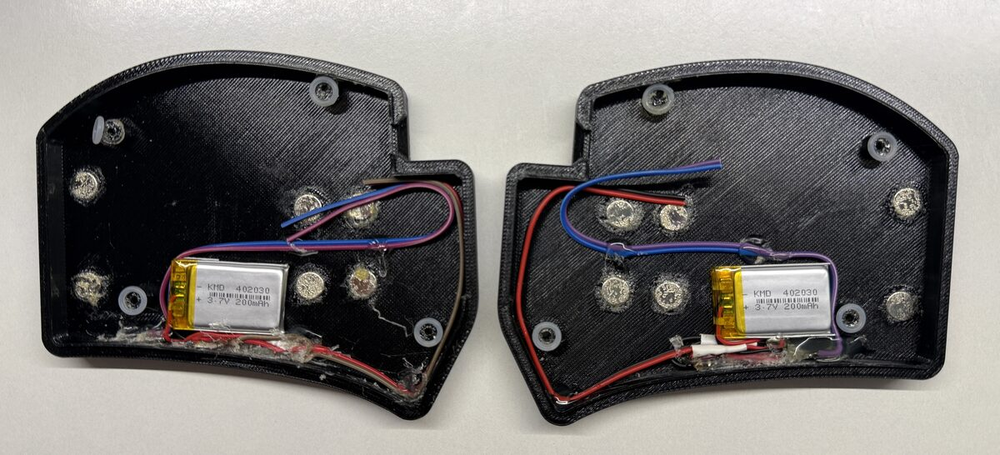
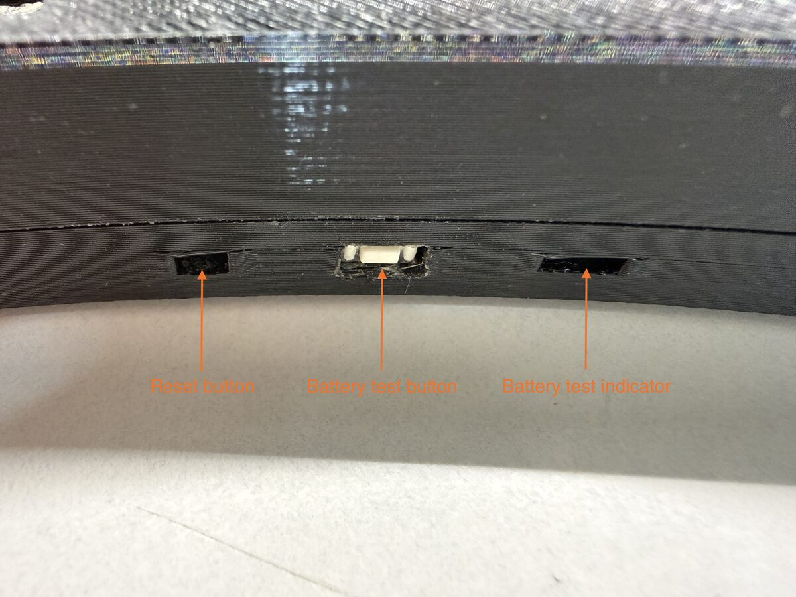
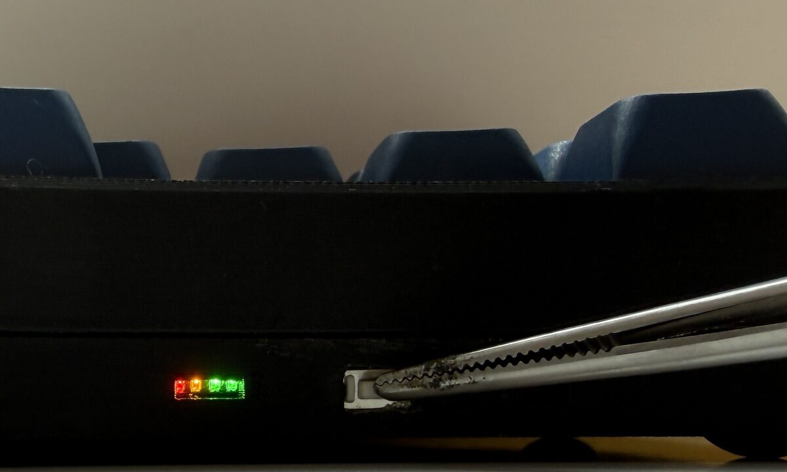
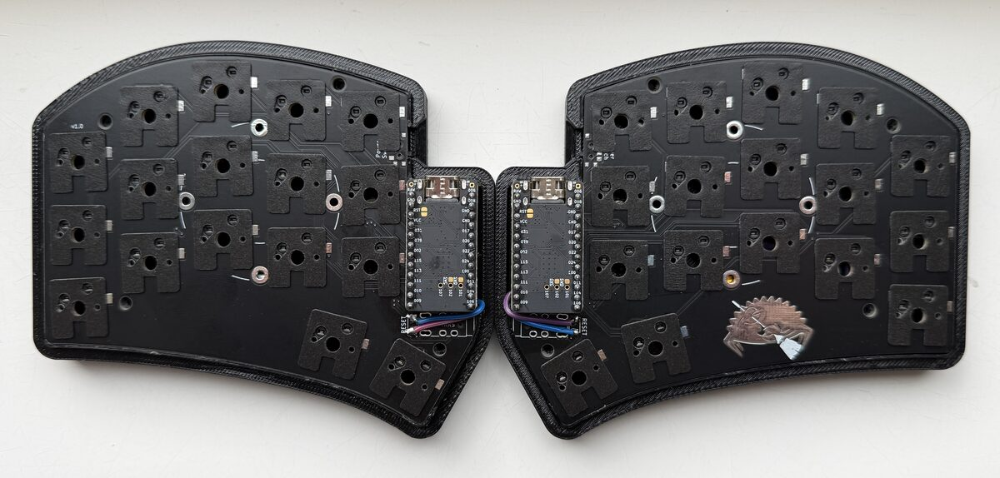
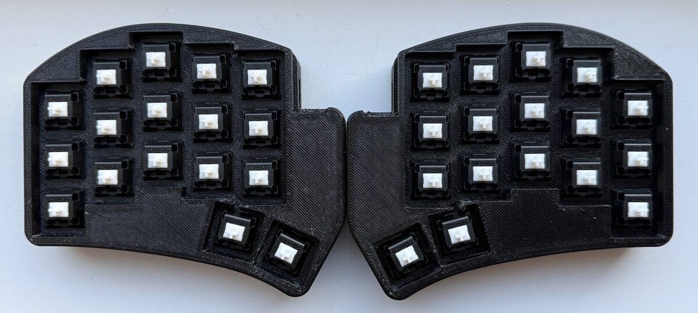
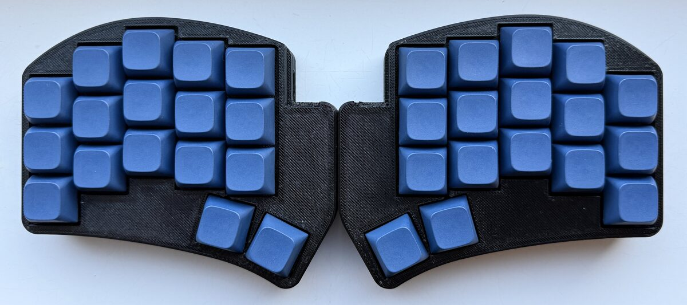
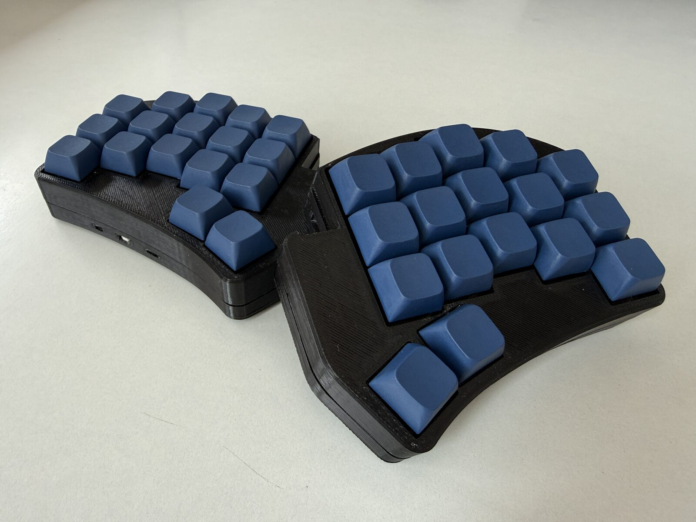

# Sweep Split Keyboard

A wireless 34-key split ergonomic keyboard based on the [Sweep Bling MX](https://github.com/davidphilipbarr/Sweep) PCB, powered by [nice!nano v2](https://nicekeyboards.com/nice-nano/) controllers running [ZMK firmware](https://zmk.dev/).

## Build Gallery

<a href="gallery/1.jpg"></a>
<a href="gallery/2.jpg"></a>
<a href="gallery/3.jpg"></a>
<a href="gallery/3.1.jpg"></a>
<a href="gallery/4.jpg"></a>
<a href="gallery/5.jpg"></a>
<a href="gallery/6.jpg"></a>



## Hardware

| Component | Specification |
|-----------|---------------|
| PCB | Sweep Bling MX (reversible, direct-pin wiring, no diodes) |
| Controller | nice!nano v2 — `nice_nano//zmk` (nRF52840, Bluetooth 5.0) |
| Switches | Gazzew Black Boba U4 (silent tactile, MX hotswap) |
| Battery | 402030 Li-Po 200 mAh (one per half) |
| Battery indicator | 4-LED level indicator, button-activated |
| Keys | 34 (5 columns x 3 rows + 2 thumb keys per side) |

### Case

Custom 3D-printed case with:
- Access hole for the reset button on the side
- Two CAD sources: OpenSCAD (`sweep_case.scad`) and CadQuery/Python (`sweep_case.py`)
- The Python source generates more optimal STL geometry

Case files are in the [`case/`](case/) directory.

> [!WARNING]
> The case model is a work in progress. The current design has known fit issues and required manual corrections after printing. Improvements are planned for a future revision.

### Battery Indicator

Each half includes a small 4-LED battery level indicator board. Press the button on the indicator to check the current Li-Po charge level.

## Firmware

ZMK firmware with Bluetooth connectivity. The firmware is built automatically via GitHub Actions on every push.

### Keymap

7 layers with home row mods, mouse keys, and a conditional function layer.

```
BASE (QWERTY + home row mods)
┌─────┬─────┬─────┬─────┬─────┐   ┌─────┬─────┬─────┬─────┬─────┐
│  Q  │  W  │  E  │  R  │  T  │   │  Y  │  U  │  I  │  O  │  P  │
├─────┼─────┼─────┼─────┼─────┤   ├─────┼─────┼─────┼─────┼─────┤
│ALT/A│CTL/S│SFT/D│GUI/F│HYP/G│   │HYP/H│GUI/J│SFT/K│CTL/L│ALT/;│
├─────┼─────┼─────┼─────┼─────┤   ├─────┼─────┼─────┼─────┼─────┤
│  Z  │  X  │  C  │  V  │  B  │   │  N  │  M  │  ,  │  .  │  /  │
└─────┴─────┴─────┼─────┼─────┤   ├─────┼─────┼─────┴─────┴─────┘
                  │S/TAB│N/SPC│   │M/RET│#/BSP│
                  └─────┴─────┘   └─────┴─────┘
  S=SYM  N=NAV  M=MOUSE  #=NUM   (hold = layer, tap = key)

SYM (symbols)
┌─────┬─────┬─────┬─────┬─────┐   ┌─────┬─────┬─────┬─────┬─────┐
│  !  │  @  │  #  │  $  │  %  │   │  ^  │  &  │  *  │  (  │  )  │
├─────┼─────┼─────┼─────┼─────┤   ├─────┼─────┼─────┼─────┼─────┤
│ALT/.│CTL/,│SFT/"│GUI/'│  |  │   │  -  │GUI/=│SFT/`│CTL/[│ALT/]│
├─────┼─────┼─────┼─────┼─────┤   ├─────┼─────┼─────┼─────┼─────┤
│  ?  │  /  │  <  │  >  │  \  │   │  _  │  +  │  ~  │  [  │  ]  │
└─────┴─────┴─────┼─────┼─────┤   ├─────┼─────┼─────┴─────┴─────┘
                  │     │     │   │     │     │
                  └─────┴─────┘   └─────┴─────┘

NAV (navigation)
┌─────┬─────┬─────┬─────┬─────┐   ┌─────┬─────┬─────┬─────┬─────┐
│     │     │CAPS │CAPWD│     │   │HOME │PG_DN│PG_UP│ END │     │
├─────┼─────┼─────┼─────┼─────┤   ├─────┼─────┼─────┼─────┼─────┤
│ ALT │ CTL │ SFT │ GUI │     │   │  ←  │  ↓  │  ↑  │  →  │     │
├─────┼─────┼─────┼─────┼─────┤   ├─────┼─────┼─────┼─────┼─────┤
│     │     │COPY │PASTE│     │   │     │     │     │     │     │
└─────┴─────┴─────┼─────┼─────┤   ├─────┼─────┼─────┴─────┴─────┘
                  │     │     │   │     │ DEL │
                  └─────┴─────┘   └─────┴─────┘

NUM (numbers + function keys)
┌─────┬─────┬─────┬─────┬─────┐   ┌─────┬─────┬─────┬─────┬─────┐
│ F1  │ F2  │ F3  │ F4  │ F5  │   │ F6  │ F7  │ F8  │ F9  │ F10 │
├─────┼─────┼─────┼─────┼─────┤   ├─────┼─────┼─────┼─────┼─────┤
│ALT/1│CTL/2│SFT/3│GUI/4│  5  │   │  6  │GUI/7│SFT/8│CTL/9│ALT/0│
├─────┼─────┼─────┼─────┼─────┤   ├─────┼─────┼─────┼─────┼─────┤
│ F11 │     │     │     │     │   │     │     │     │     │ F12 │
└─────┴─────┴─────┼─────┼─────┤   ├─────┼─────┼─────┴─────┴─────┘
                  │     │     │   │     │     │
                  └─────┴─────┘   └─────┴─────┘

MOUSE (mouse movement — right hand IJKL style)
┌─────┬─────┬─────┬─────┬─────┐   ┌─────┬─────┬─────┬─────┬─────┐
│     │     │     │     │     │   │     │     │  ↑  │     │     │
├─────┼─────┼─────┼─────┼─────┤   ├─────┼─────┼─────┼─────┼─────┤
│ ALT │ CTL │ SFT │ GUI │SCRL │   │     │  ←  │  ↓  │  →  │     │
├─────┼─────┼─────┼─────┼─────┤   ├─────┼─────┼─────┼─────┼─────┤
│     │     │     │     │     │   │     │     │     │     │     │
└─────┴─────┴─────┼─────┼─────┤   ├─────┼─────┼─────┴─────┴─────┘
                  │RCLK │LCLK │   │     │     │
                  └─────┴─────┘   └─────┴─────┘

FUN (conditional: NAV + MOUSE held simultaneously)
┌─────┬─────┬─────┬─────┬─────┐   ┌─────┬─────┬─────┬─────┬─────┐
│ BT0 │     │PREV │NEXT │PLAY │   │ BT3 │     │     │USTCK│RESET│
├─────┼─────┼─────┼─────┼─────┤   ├─────┼─────┼─────┼─────┼─────┤
│ BT1 │     │VOL- │VOL+ │MUTE │   │ BT4 │     │     │     │BOOT │
├─────┼─────┼─────┼─────┼─────┤   ├─────┼─────┼─────┼─────┼─────┤
│ BT2 │     │BRI- │BRI+ │     │   │ BT5 │     │     │     │BTCLR│
└─────┴─────┴─────┼─────┼─────┤   ├─────┼─────┼─────┴─────┴─────┘
                  │     │     │   │     │     │
                  └─────┴─────┘   └─────┴─────┘
```

### Combos

| Keys | Action | Active Layers |
|------|--------|---------------|
| K + L | Escape | BASE |
| S + D | Escape | BASE, MOUSE |

### Features

- **Home row mods** with bilateral hold-trigger (left mods trigger on right-hand keys and vice versa)
- **Hyper key** (Ctrl+Shift+Alt+GUI) on G and H
- **Mouse keys** with movement and scroll layers
- **Conditional FUN layer** activates when NAV + MOUSE are held together
- **Key repeat** on double-tap of any thumb key
- **Deep sleep** after 30 minutes of inactivity
- **Bluetooth** with +8 dBm TX power for extended range

## Building Firmware

### GitHub Actions (recommended)

Push to the repository and GitHub Actions will build the firmware automatically. Download the `.uf2` files from the Actions artifacts.

### Local Build (Docker)

```bash
./build.sh          # build all (left, right, settings_reset)
./build.sh left     # build left half only
./build.sh right    # build right half only
./build.sh reset    # build settings_reset only
```

### Flashing

1. Connect the nice!nano via USB
2. Double-press the reset button to enter bootloader mode (the nice!nano mounts as a USB drive)
3. Copy the `.uf2` file to the mounted drive
4. The controller will flash and reboot automatically
5. Repeat for the other half

To clear Bluetooth bonds, flash `settings_reset.uf2` to both halves first.

## Repository Structure

```
.
├── .github/workflows/  # GitHub Actions CI
│   └── build.yml
├── case/               # 3D-printable case files
│   ├── sweep_case.py       # CadQuery source (generates optimal STL)
│   ├── sweep_case.scad     # OpenSCAD source
│   ├── sweep_case_bottom.stl
│   └── sweep_case_top.stl
├── config/             # ZMK firmware configuration
│   ├── cradio.conf
│   ├── cradio.json
│   ├── cradio.keymap
│   └── west.yml
├── firmware/           # Built .uf2 files (local builds)
├── gallery/            # Build photos (1-6: build stages, 7: final)
├── build.sh
├── build.yaml
└── README.md
```

## References

- [Sweep PCB](https://github.com/davidphilipbarr/Sweep) — original Sweep/Ferris Sweep design by David Philip Barr
- [ZMK Firmware](https://zmk.dev/) — open-source keyboard firmware
- [nice!nano](https://nicekeyboards.com/nice-nano/) — nRF52840 Pro Micro-compatible controller
- [Cradio shield (ZMK)](https://github.com/zmkfirmware/zmk/tree/main/app/boards/shields/cradio) — built-in ZMK shield for Sweep/Cradio

## License

Case designs and firmware configuration are provided as-is for personal use.
